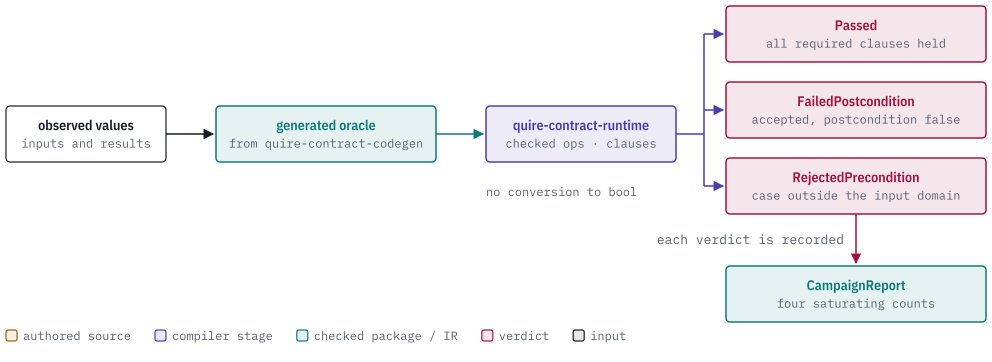

# Quire Contract Runtime

[](https://discord.gg/k8DVhuYBR2)

`quire-contract-runtime` is a small `no_std` Rust library of verdict types for
contract testing. A verdict is one of three results: the output matches, the
output is wrong, or the input failed the precondition.

Oracles generated by `quire-contract-codegen` link against it, and test
harnesses read its verdicts. A verdict has no conversion to `bool`; a failed
precondition is reported separately from a pass.

<picture>
  <source media="(prefers-color-scheme: dark)" srcset="docs/images/hero-dark.svg">
  
</picture>

> **Status: public prerelease.** The API is still changing, the crate is `publish = false`, and
> nothing is released to a registry yet. Expect breaking changes.

## Usage

A verdict carries the identity of the contract (requirement and revision), the point in execution
where it was checked, and the clauses that were observed. This is the fixture and the campaign
test from [`tests/integration.rs`](tests/integration.rs):

```rust
use quire_contract_runtime::{
    CampaignReport, ClauseId, ClauseKind, ClauseOutcome, ContractIdentity, ExecutionPoint,
    FailureDetail, FailureKind, Observation, RequirementId, RevisionId, Verdict, VerdictContext,
};

static OBSERVATIONS: [Observation<'static>; 1] = [Observation::new(
    ClauseId::new("post-1"),
    ClauseKind::Postcondition,
    ClauseOutcome::Failed,
    Some(FailureDetail::new(
        ClauseId::new("post-1"),
        FailureKind::Postcondition,
        17,
        Some("expected output"),
    )),
)];
let identity = ContractIdentity::new(RequirementId::new("FR-001"), RevisionId::new("rev-7"));
let context = VerdictContext::new(
    identity,
    ExecutionPoint::new("after-handler"),
    &OBSERVATIONS,
);
let detail = OBSERVATIONS[0].detail.unwrap();

let mut report = CampaignReport::new(identity);
assert!(report.record_verdict(&Verdict::passed(context)).is_ok());
assert!(report
    .record_verdict(&Verdict::failed_postcondition(context, detail))
    .is_ok());
assert!(report
    .record_verdict(&Verdict::rejected_precondition(context, detail))
    .is_ok());
report.record_discard();

assert_eq!(report.counts().accepted(), 2);
assert_eq!(report.counts().failed(), 1);
assert_eq!(report.counts().rejected(), 1);
assert_eq!(report.counts().discarded(), 1);
assert_eq!(report.counts().total(), 4);
assert_eq!(
    report.to_string(),
    "requirement=FR-001 revision=rev-7 accepted=2 rejected=1 failed=1 discarded=1"
);
```

In a campaign, a failed postcondition counts as accepted (the input was valid) and as failed. A
rejected precondition counts as rejected. Recording a verdict for a different contract identity
returns an error.

## Modules

| Module | What it gives a generated oracle |
| --- | --- |
| `identity` | Borrowed requirement, revision, execution-point and clause identities. |
| `observation` | Per-clause outcomes (`Passed`, `Failed`, `Rejected`, `NotEvaluated`, `Undefined`), clause kinds, and allocation-free failure details. |
| `verdict` | `Verdict`: `Passed`, `FailedPostcondition` or `RejectedPrecondition`, with no conversion to `bool`. |
| `operators` | Separately named short-circuit and total `and`, `or` and `implies`; checked option, slice-index, add, sub, mul, div and rem helpers that return `None` when undefined. |
| `accounting` | `CampaignReport` and `CampaignCounts`: accepted, rejected, failed and discarded counts that saturate and do not panic. |
| `proptest_adapter` | Optional: maps a verdict onto proptest's success, failure and rejection. |
| `exact` | Optional: runtime-owned negotiation and the remaining exact-value helpers, built on `quire-exact` and `quire-semantic-value`. |

## Features

The default feature set is empty, so the core is `no_std`, allocation-free and dependency-free.

| Feature | Adds |
| --- | --- |
| `alloc` | Opt-in convenience surfaces that need an allocator. |
| `std` | Implies `alloc`. |
| `proptest` | The proptest adapter. Implies `std`; meant for development harnesses only. |
| `snapshot-json` | Encode and decode a campaign snapshot as bounded JSON (`runtime.campaign-snapshot/v1`). Implies `alloc`. |
| `exact` | The `exact` module and its dependencies on `quire-exact` and `quire-semantic-value`. Implies `alloc`. |

```toml
[dependencies]
quire-contract-runtime = { git = "https://github.com/agent-ix/quire-contract-runtime", default-features = false }

[dev-dependencies]
quire-contract-runtime = { git = "https://github.com/agent-ix/quire-contract-runtime", features = ["proptest"] }
```

## Guarantees and limits

- The core is safe Rust (`#![forbid(unsafe_code)]`), performs no allocation or I/O, and has no
  required dependency.
- Undefined partial operations return `None`; counters saturate and do not panic.
- Public data enums are `#[non_exhaustive]`, so consumers must handle unknown future states and
  cannot treat them as success.
- Exact type and release artifact sizes are target-dependent. The size gate fixes Rust 1.98.1 and
  `thumbv7em-none-eabi`, then limits the representative static-library consumer's linked `.text`
  plus `.rodata` to 4 KiB with no panic relocation.
- A decoded snapshot is validated for shape and limits. Validation does not authenticate that the
  campaign ran.

## Quire ecosystem

<picture>
  <source media="(prefers-color-scheme: dark)" srcset="docs/images/ecosystem-dark.svg">
  
</picture>

`quire-contract-runtime` is a backend. The oracles that `quire-contract-codegen` emits link it. Its only first-party
dependencies are the optional `quire-exact` and `quire-semantic-value` crates, pulled in by the
`exact` feature.

## Building and testing

```bash
make ci          # every mandatory local gate; hosted CI stays manual-only
```

`make ci` runs formatting, the spec check, clippy, the feature matrix, docs, the MSRV check, the
size gate, `cargo deny`, and the Kani proofs. The checked-in Kani harnesses run under `make kani`,
which fails when a proof fails or `cargo-kani` is absent. `make test` runs the plain test suite.
Requirements, test cases, the matrix and architecture descriptions live under `spec/`; plans
under `plan/`; and code reviews and gap analyses under `reviews/`.

## Contributing

Every contribution needs a signed Contributor License Agreement; see [CONTRIBUTING.md](CONTRIBUTING.md)
and [CLA.md](CLA.md). Agent-assisted contributions are welcome and held to the same traceability
and review as every other contribution.

## License

Licensed under the GNU Affero General Public License, version 3 or (at your option) any later
version (`AGPL-3.0-or-later`). See [LICENSE](LICENSE).
